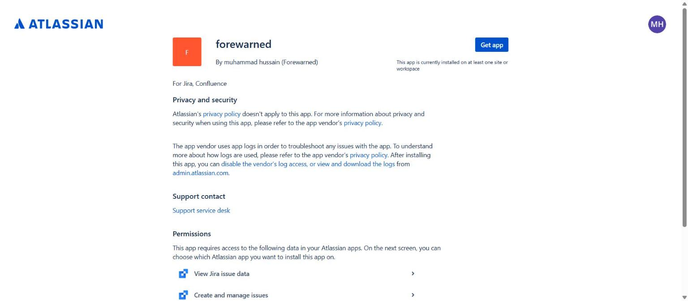
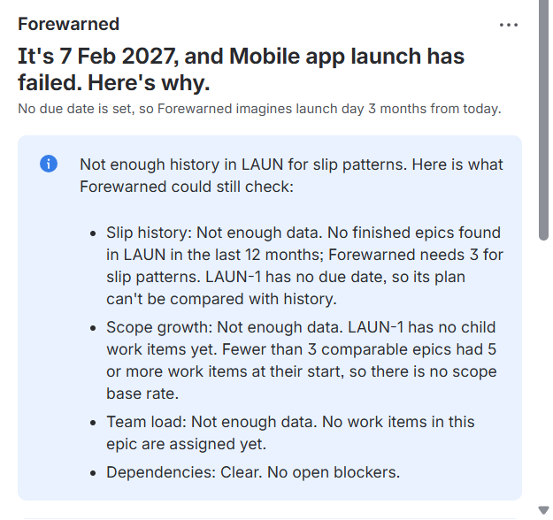
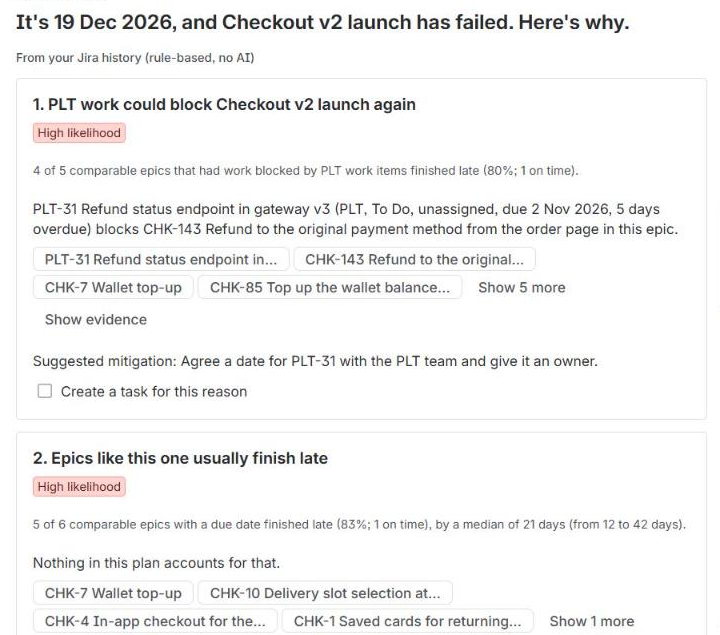

# Forewarned: judge setup

Forewarned runs an evidence-based pre-mortem on a Jira epic: it imagines the epic has already failed and shows the most likely reasons, each backed by facts from your team's own Jira history. Try it on your own site in about 5 minutes; optional demo history in about 15 more. You need no API token, no command line and no payment.

## What you need

- A Jira Cloud site where you are a site admin. A free developer site from https://go.atlassian.com/cloud-dev works.
- Optional: Confluence on the same site, to export the pre-mortem as a page.
- Optional: Rovo on the same site, for the Forewarned agent. A free developer site doesn't have Rovo turned on (checked 7 Nov 2026); there the panel says so and everything else works.

This guide uses Jira's English menu names. If your site uses another language, the menu names differ, but the Forewarned panel can still be added to every epic. Jira now says "space" where it used to say "project"; JQL and the importer still say `project`.

## Install

1. Sign in to your site as an admin, then open the installation link: **[Install Forewarned](https://developer.atlassian.com/console/install/d25bd899-00db-4ac1-a33b-c001e7d4b41c?signature=AYABeNihaOVScAQTbxthps763SoAAAADAAdhd3Mta21zAEthcm46YXdzOmttczp1cy13ZXN0LTI6NzA5NTg3ODM1MjQzOmtleS83MDVlZDY3MC1mNTdjLTQxYjUtOWY5Yi1lM2YyZGNjMTQ2ZTcAuAECAQB4CxqLTo9l4lqXuFjNim1xJM%2Bp%2F3TVP9xHS2BrU5DRRucBXEZznviMHaD3Po8hWB7mSwAAAH4wfAYJKoZIhvcNAQcGoG8wbQIBADBoBgkqhkiG9w0BBwEwHgYJYIZIAWUDBAEuMBEEDEmip1ON4kzfb6uP9QIBEIA7pqNm1T8Tw%2BETE6dxExcr5JiQsn2Pp4ub7VUBlVp5b9iI2VffrYr27liOaDE4PCsXnHz7wU54t8cXndIAB2F3cy1rbXMAS2Fybjphd3M6a21zOmV1LXdlc3QtMTo3MDk1ODc4MzUyNDM6a2V5LzQ2MzBjZTZiLTAwYzMtNGRlMi04NzdiLTYyN2UyMDYwZTVjYwC4AQICAHi9bVMAkme4qVQX1fQHo6ePw3H40A7cGfz7yrmSfBWMXgHmGH6CNBVM%2BMqdHGbctRkCAAAAfjB8BgkqhkiG9w0BBwagbzBtAgEAMGgGCSqGSIb3DQEHATAeBglghkgBZQMEAS4wEQQMmV3SUm80PS3o1I4iAgEQgDsSTuQjIxhxB%2BBobia6SkFzqy9U4BL%2FmnHd8QhvO9CetTitcpTcGm29x%2FFeSAJBpPIl3LH7OtvQAnYEbQAHYXdzLWttcwBLYXJuOmF3czprbXM6dXMtZWFzdC0xOjcwOTU4NzgzNTI0MzprZXkvNmMxMjBiYTAtNGNkNS00OTg1LWI4MmUtNDBhMDQ5NTJjYzU3ALgBAgIAeDYASx0XCjkny4iLV6vz%2BKtEGSGT6kdt0QRpkn6D%2FlVEAWH8y4f%2FYxosigqSSKvt7zYAAAB%2BMHwGCSqGSIb3DQEHBqBvMG0CAQAwaAYJKoZIhvcNAQcBMB4GCWCGSAFlAwQBLjARBAwlzAF16yI8zAiIw6UCARCAO7dh%2FflmlA25gVOcNAjmVuLIGswfocpw400S4Y67rwLfgKRN%2BfZAAIz4ogGlmPNnbyJk9uNjhrqx66SIAgAAAAAMAAAQAAAAAAAAAAAAAAAAANSLlSWL%2BOmPfXnqZ3q3plf%2F%2F%2F%2F%2FAAAAAQAAAAAAAAAAAAAAAQAAADKUSDnocQgxyiig0BOpJOd0BOKi56OTSDkOwYY12p%2FjgL%2BZ8JqxBjWSX3O5XdIN9jUoD%2F8AOMnBCdpdOgYqIsQk%2B%2FQ%3D&product=jira&product=confluence)**
2. The page shows the app as **forewarned** with its permissions (explained in [Privacy and data](#privacy-and-data)). Click **Get app**, choose your site under **Select a site to install this app on**, and click **Install**. Wait for "Installation successful" next to Jira (about a minute).
   - For the optional Confluence page, also tick **Confluence** under "Select any additional Atlassian apps that you would like to connect this app to" before you click **Install**.

   

3. Check the version: open **admin.atlassian.com**, choose your site, then **Connected apps** (Jira's old **Manage apps** page now links there with **Take me there**). Search `forewarned` and click **View app details**: the version should read **2.0.0** or later.
4. Optional, if you didn't tick Confluence in step 2: on the same app details page, open the **Connections** tab, click **Connect** next to **Confluence**, then **Connect** again in the panel that lists the Confluence permissions.
   Skip this step if you don't use Confluence. Everything else works without it.

## First run on a fresh site

1. Open any **epic**. Forewarned works on epics only, not on stories, tasks or bugs.
   - No epic yet? Create a space first: **Spaces** in the sidebar → **+** (Create space) → **Scrum** or **Kanban** → **Use template**, type a name, pick either option under **How your space is managed**, then **Next**, **Next**, **I'll do this later** and **Done**. Then click **+ Create** in Jira's top bar, set the work type to **Epic**, type a summary and click **Create**. That takes about 2 minutes. Or skip to [Optional demo history](#optional-demo-history), which brings its own epics.
2. Add the **Forewarned** panel: click the apps icon below the epic's title (its tooltip reads **View app actions**) and pick **Forewarned**. You do this once per epic; after that the panel stays.
   - The panel takes a few seconds to load once it scrolls into view (up to about 30 seconds after a full page reload).
3. The panel says "Imagine this epic has already failed. Forewarned finds the most likely reasons in your team's Jira history and links the proof." Click **Run pre-mortem**.
4. The steps tick off as the run goes: "Finding comparable epics", "Reading past epics", "Checking scope growth", "Checking team load", "Checking dependencies", "Writing the pre-mortem". A run usually takes under 30 seconds.

What you see on a site with no history:

- The headline "It's [date], and [your epic] has failed. Here's why." On a new site, the why is the checks list below. Without a due date, a note follows: "No due date is set, so Forewarned imagines launch day 3 months from today."
- An information box: "Not enough history in [space key] for slip patterns. Here is what Forewarned could still check:", with one line each for **Slip history**, **Scope growth**, **Team load** and **Dependencies**, marked "Found", "Clear" or "Not enough data" with a note. On a new, empty epic, the first three say "Not enough data" and Dependencies says "Clear. No open blockers." For example, the slip line starts "Slip history: Not enough data. No finished epics found in [space key] in the last 12 months; Forewarned needs 3 for slip patterns."
- No made-up reasons. Forewarned shows a reason only when the history supports it, so a new site gets this honest answer.
- Below it: "Last run just now ([date, time]) by [your name]" and **Re-run**. Without Confluence or Rovo, the panel says so in one line each, and nothing else changes.

For the full demo, add the history below.

## Optional demo history

About 15 minutes, 6 of them waiting for the import. You create two empty spaces and import a year of seeded delivery history into them: Checkout (CHK, 162 work items) and Platform (PLT, 32), with epics, blockers and dates counted from the day you import. The file names no people, so the import creates no user accounts.

1. Create the space **Checkout**: **Spaces** in the sidebar → **+** (Create space) → **Scrum** → **Use template**. Name `Checkout`; under **How your space is managed** choose **Company-managed**; replace the suggested key (`CHEC`) with `CHK`. Then **Next**, **Next**, **I'll do this later** and **Done**. The key must be exactly `CHK`.
2. Create the space **Platform** the same way: Scrum, name `Platform`, **Company-managed**, key `PLT`.
3. In each of the two spaces: **Space settings → Details**, check that **Default assignee** is **Unassigned** (it was on our fresh site); if not, set it and save. If Unassigned isn't offered, turn on unassigned work items in **Settings (gear) → System → General configuration** first.
4. Check for sample work items: open `https://<your-site>.atlassian.net/issues/?jql=project%20in%20(CHK%2C%20PLT)`. On our fresh site the list was empty (7 Nov 2026). Older Scrum templates added 2 per space; if you see any, open each one and use **⋯ (More actions) → Delete**.
5. Download `forewarned-demo.json`: open https://github.com/Hussnain-Butt/forewarned/blob/main/scripts/seed/forewarned-demo.json and click **Download raw file**. No GitHub account is needed.
6. Import it: **Settings (gear) → System → External system import**. The page opens in the new import experience, which has no JSON option: click **Switch to the old experience**, then **JSON**. Choose the file and click **Begin Import**; there is nothing to map. After about 6 minutes: "0 projects and 194 work items imported successfully!" "0 projects" is right: you created both spaces in steps 1–2. A warning "Component lead null not found" is harmless (the seeded components have no lead).
7. Make yourself the busy backend engineer. The seed names no real people, so nothing is assigned yet, and the load risk needs a person. Open `https://<your-site>.atlassian.net/issues/?jql=project%20in%20(CHK%2C%20PLT)%20AND%20labels%20%3D%20seed-role-backend` (67 work items). Click **⋯** at the top right of the list → **Bulk change work items**; in the page that opens, tick the box that selects all 67 → **Next** → **Edit Work items** → **Next** → tick **Change Assignee**, click **Assign to me**, leave **Send mail for this update** unticked → **Next** → **Confirm**. It takes about 20 seconds.
8. Open **Checkout v2 launch**: search `project = CHK AND issuetype = Epic AND statusCategory = "In Progress"` and open **Checkout v2 launch** (the other result is Gift cards at checkout). Add the panel if needed ([First run](#first-run-on-a-fresh-site), step 2) and click **Run pre-mortem**, or **Re-run** if you ran it before step 7.

The importer also adds a site custom field, **External issue ID**. Forewarned doesn't use it.

## Expected results with the demo history

On **Checkout v2 launch** the headline reads "It's [date], and Checkout v2 launch has failed. Here's why." The date is the epic's due date, 42 days after your import. The reasons sit under "From your Jira history (rule-based, no AI)", and "Compared with 8 finished epics in CHK (matched on components Payments, Web)" names the comparison set.

The seed plants 5 risks. Each one appears as a rule-based reason:

| Planted risk | Reason in the panel | Likelihood | What the cited evidence says |
|---|---|---|---|
| P1 Platform dependency repeats | "PLT work could block Checkout v2 launch again" | High | An open, unassigned PLT work item, "Refund status endpoint in gateway v3", is 5 days overdue and blocks "Refund to the original payment method from the order page"; 4 of 5 comparable epics that had work blocked by PLT work items finished late |
| P2 Comparable epics finish late | "Epics like this one usually finish late" | High | 5 of 6 comparable epics with a due date finished late, by a median of 21 days (from 12 to 42 days) |
| P3 The plan is shorter than history | "The plan is shorter than comparable epics took" | High | The epic is planned for 56 days; 7 of 8 comparable epics took longer, with a median of 77 days |
| P4 Scope keeps growing | "Scope will keep growing after the plan is set" | High | The epic started with 15 work items and has gained 6 since, 40% more; comparable epics gained a median of 40% (from 20% to 60%) |
| P5 One person is spread thin | "[Your name]'s workload could slow Checkout v2 launch" | Medium | You have open work items in 2 other epics in progress, Payment gateway API v3 (PLT) and Gift cards at checkout (CHK): 14 open work items in total, 6 of them in this epic, plus any you already had |

- The 4 High reasons come first, in this order, then the Medium one.
- P5 appears only after the self-assign (step 7). It fires because you have open work in 2 other epics in progress.
- If you skipped only step 7, the other 4 show and the list ends with "Not enough evidence for more reasons."
- Day counts can differ by one because of time zones, and the overdue count grows by one each day after the import.
- What you should not see: "Gateway v3 client library for internal services" as an open blocker. It is a planted decoy that is already resolved.

Each reason shows "Suggested mitigation: …", chips that open the work items behind it, **Show evidence** for the cited facts, and a checkbox, **Create a task for this reason**.

The run buttons: **Run pre-mortem** before the first report, **Re-run** after it, **Run again anyway** in the "nothing has changed" notice, and **Try again** after a failed run.

Then try the actions:

- Tick 2 reasons; the button below them reads **Create 2 tasks**. Click it: Forewarned creates the tasks under the epic, as you, and the panel says "Created 2 tasks:" with a link to each new key.
- Needs the Confluence connection ([Install](#install), step 2 or 4): click **Create Confluence page**, pick a space (a new site has one, "Software Development"; create one in Confluence first if the list is empty) and click **Create page**. The panel says "Page created in [space]." with a link. The page follows the structure of Atlassian's premortem template.

## Rovo agent

The Forewarned agent writes a pre-mortem in its own words from the same evidence, and answers questions about it. It needs Rovo on your site and uses your site's own Rovo credits, like any Rovo agent. The panel works fully without Rovo; on a site without it, the panel says "Rovo isn't turned on for this site, so the agent write-up isn't available. The rule-based pre-mortem works without it."

From the panel (after a run, with permission to edit the epic):

1. Click **Write with Forewarned agent**. Rovo chat opens with the Forewarned agent and the request "Write the pre-mortem for epic [key]." The panel shows "Waiting for the Forewarned agent to save its write-up…".
2. The agent reads the evidence and writes up to 5 reasons. Rovo asks you to confirm **Save pre-mortem**; confirm it.
3. Forewarned checks every reason against the evidence before saving it, and drops any reason that cites missing evidence or a number the evidence doesn't hold. The panel switches to the **Agent write-up** tab without a reload, labelled "Written by the Forewarned agent in Rovo and checked against the evidence". If a reason was dropped, the panel says "The agent proposed [n] reasons; [d] were dropped because their evidence didn't check out." The **Rule-based** tab keeps the rule-based reasons.

From Rovo chat:

1. Open the epic, then open Rovo chat from Jira's top bar.
2. In the chat header, pick the **Forewarned** agent; if it isn't listed, open **Browse agents** and search for Forewarned. Rovo's default agent doesn't know Forewarned and searches the site instead.
3. Start with "Run a pre-mortem on this epic". The other 2 conversation starters work once a pre-mortem exists:
   - "Why is reason 1 likely?"
   - "Show the last pre-mortem for this epic"
4. Rovo asks you to confirm **Run pre-mortem** and **Save pre-mortem** before the agent starts a run or saves. After the save, the panel's **Agent write-up** tab shows it (reload the page if the panel was already open). Runs from chat count toward the same daily limit as the panel.

## Troubleshooting

| Symptom | Cause and fix |
|---|---|
| You can't find the panel on a story or task | Forewarned works on epics only, so Jira doesn't offer it on other work items. Open an epic. If a work item stops being an epic, its panel says "This panel works on epics only." |
| No panel on an epic | Jira shows an app's panel once you add it, once per epic: click the apps icon below the title (**View app actions**), then **Forewarned**. If Forewarned isn't listed, check the install ([Install](#install), step 3). |
| The panel takes a few seconds to appear after the work item opens | Normal. Jira loads app panels only when they scroll into view, then starts the app: a few seconds, up to about 30 seconds after a full page reload. Scroll to the panel and wait; a spinner shows meanwhile. |
| **Run pre-mortem** is disabled: "You need permission to edit this epic to run a pre-mortem. Ask a space admin." | Running needs permission to edit the epic. Anyone who can see the epic can read its report. |
| "Forewarned has run 15 pre-mortems on this site today, the daily limit that keeps it free to run. It resets at …" | Each site can start 15 runs per UTC day; the count resets at 00:00 UTC, shown in your local time. The last report stays readable. |
| "New runs are paused on this site for now, to keep Forewarned free to run." | The developer has paused new runs for every site. Reports stay readable. |
| "Nothing in this epic has changed since the last run at …, so Forewarned is showing that report." | An unchanged epic reuses its run from the last 24 hours. Click **Run again anyway** for a new run; it counts toward the daily limit. |
| No **Write with Forewarned agent** button, or "Rovo isn't turned on for this site, …" | The agent button needs Rovo on the site, a report on the epic and permission to edit it. The rule-based pre-mortem works without Rovo. |
| The agent didn't save | The agent saves only after you confirm **Save pre-mortem** in Rovo chat; after a cancel it says nothing was saved. Check that the chat header shows the **Forewarned** agent. After 3 minutes the panel says "The Forewarned agent hasn't saved a write-up yet." and offers **Check again**. |
| "Confluence isn't available for Forewarned on this site, so it can't create a page. Everything else works." | Confluence isn't on the site, or Forewarned isn't connected to it ([Install](#install), step 4). If the panel adds "Ask your admin to update Forewarned in Confluence.", update the app's Confluence install. |
| New tasks don't show in the epic's child list: "Reload the page to see the new tasks in the child list." | Jira didn't refresh the view. Reload the page. |
| Import fails at "Retrieving projects" | A space is missing or its key differs. The importer can't create spaces: create CHK and PLT first, company-managed, with exactly these keys. |
| The import page has no JSON option | Click **Switch to the old experience**, then pick **JSON**. |
| The import ends with "Component lead null not found" | Harmless: the seeded components have no lead. Check the "194 work items imported successfully" line above it. |
| Leftover sample work items: CHK has 164 work items or PLT 34, instead of 162 and 32 | The template's sample work items are still there. Delete them; doing it after the import is fine. |
| Counts are about twice what this guide says | The file was imported twice. Delete CHK and PLT (empty them from Jira's trash too, or the keys stay taken), then repeat [Optional demo history](#optional-demo-history) steps 1–8, importing once. |
| Seeded work items are assigned to you right after the import | The space's Default assignee wasn't Unassigned. Bulk-edit `project in (CHK, PLT)` to **Unassigned** with notifications off, then do the self-assign step again. |
| No workload reason on Checkout v2 launch | Do the self-assign step ([Optional demo history](#optional-demo-history), step 7), then click **Re-run**. |
| Dates look shifted, or a day count is off by one | Seeded dates count from your import day, so they differ from our video. Time zones can move a day count by one. A report older than 24 hours says "This report is from …. Re-run to include changes since then." |
| A run failed or took too long | The panel says what went wrong and offers **Try again**. Wait a minute and try again. |
| Menu names differ from this guide | Your site's language isn't English. Look for the same place in the menus; the panel can still be added to epics. |

Still stuck? Open an issue at https://github.com/Hussnain-Butt/forewarned/issues.

## Privacy and data

What Forewarned reads, always as the person who asked (the background run reads Jira as that person too):

- the epic and its child work items;
- finished epics in the same space from the last 12 months, with their work items and change history;
- blockers linked with "is blocked by";
- the open work item counts of the people on the epic, and the other epics in progress they work on.

Where it keeps it, and what it does with it:

- The evidence and the report stay in Forge storage (Forge KVS) on Atlassian's cloud, not on the epic. Only people who can see the epic can read its report. For each reader, Forewarned reads every linked work item again and leaves out evidence they can't see ("Some reasons are hidden because they name work items you can't see or that no longer exist.").
- Personal data: the facts can name the people on the epic with their open work item counts, and the report keeps the Atlassian account ID of whoever ran it (the panel shows "Last run … by [name]") or saved the agent's write-up. They stay in Forge storage until the next run replaces them. It stores no tokens or passwords.
- It writes to Jira or Confluence only when you click: tasks (**Create [n] tasks**) and the page (**Create Confluence page**), both as you.
- It never sends data outside Atlassian. The app has no external egress, uses no AI keys and no Forge LLM. The rule-based reasons are plain code; the only AI is the optional Rovo agent, Atlassian's own AI on your site.
- Its logs hold counts and error codes only: no work item text, names or account IDs.

The permissions the install page lists: "View Jira issue data", "Create and manage issues" (for the tasks), "View spaces", "View pages", "Create and update pages" (for the optional Confluence page) and "App Storage scope" (Forge KVS). Connecting Confluence lists "View space details", "View page content" and "Create and update pages". Reading Jira also happens in the background run, as the person who started it.

**Known limit: work item level security.** Forewarned reads Jira as the person who runs a pre-mortem. When someone else opens the report, it checks every linked work item again as them and hides what they can't see. It doesn't re-check the counts inside the facts (such as "5 of 6 comparable epics"), or the list of comparable epics that the Forewarned agent reads. So on a site that restricts single work items with security levels, a reader can see counts that include work items only the runner can see, and the agent can name a comparable epic the reader can't open. We haven't tested Forewarned on a site with security levels.

## Remove it

1. Uninstall the app: **admin.atlassian.com** → your site → **Connected apps** → search `forewarned` → **View app details** → **Uninstall** (top right). Uninstalling it from Jira also removes it from Confluence. Forge keeps the app's stored reports for 28 days after uninstalling, then deletes them.
2. Delete the seeded spaces: **Spaces → View all spaces**, then **⋯ → Move to trash** for **Checkout** and **Platform**. Empty them from the trash if you want to reuse the keys.
3. Optional: delete the tasks and Confluence pages Forewarned created (they stay after uninstalling, like any work item or page) and the importer's **External issue ID** field.
